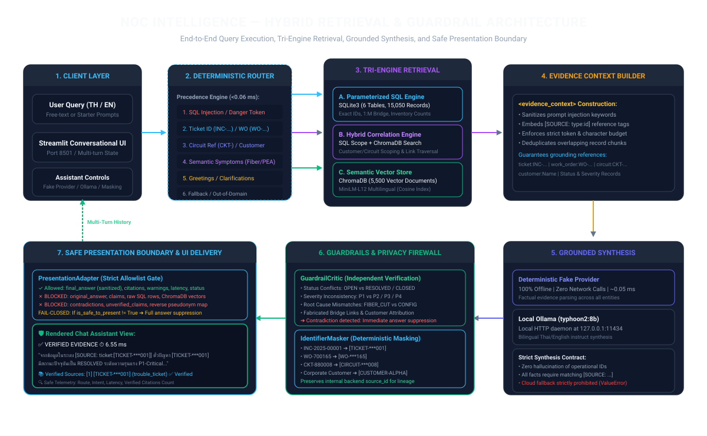
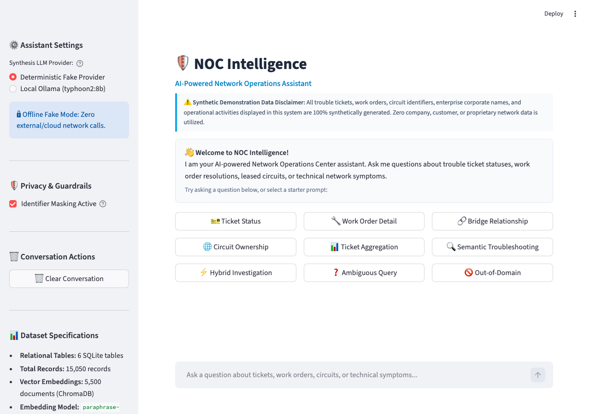
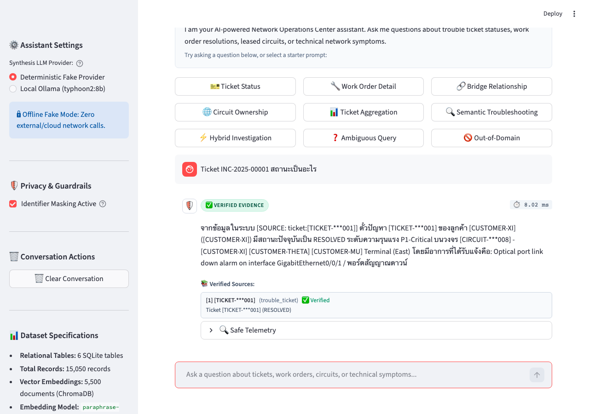
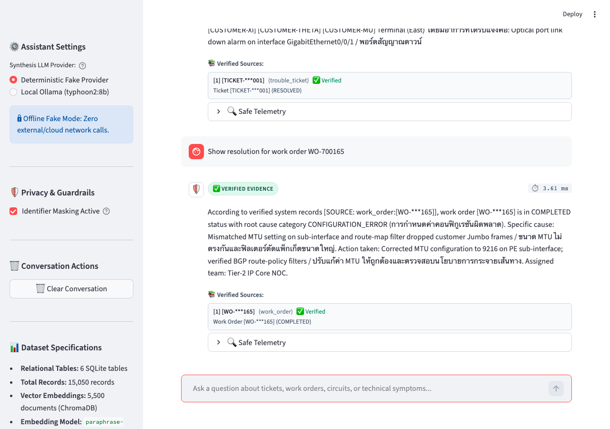
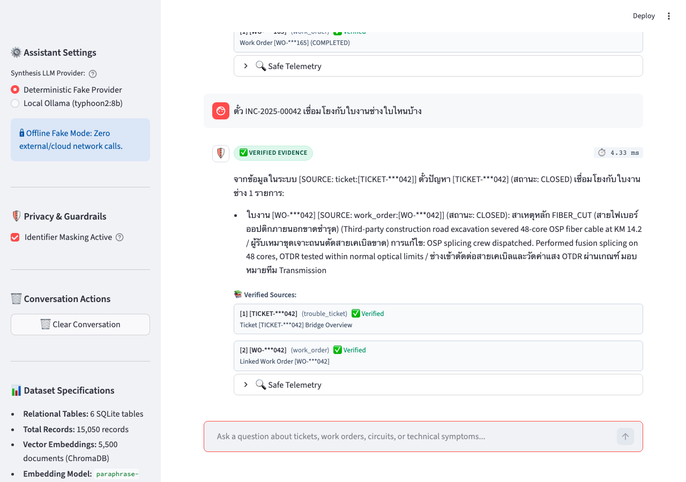
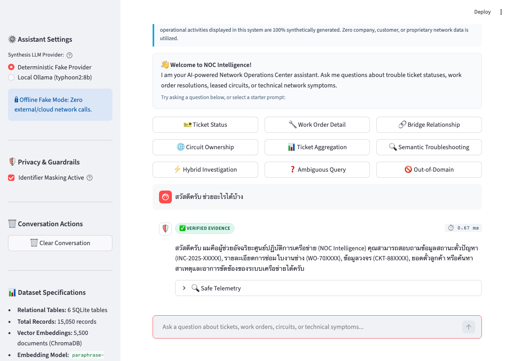

# NOC Intelligence

### AI-Powered Network Operations Intelligence Chatbot

**Status:** Independent Portfolio Demonstration  
**Data Scope:** 100% Synthetic Telecommunications Data (Zero Proprietary Data)  
**Implementation:** Stages 1–9 Complete (Synthetic Data Engine, Relational Engine, Vector Store, Deterministic Router, Grounded Synthesizer, Guardrail Critic & Identifier Masker, End-to-End Pipeline Suite, 40-Query Evaluation Benchmark, and Streamlit Chatbot UI)

---

## Table of Contents

- [1. Project Overview](#1-project-overview)
- [2. Key Features](#2-key-features)
- [3. Technical Architecture](#3-technical-architecture)
- [4. Technology Stack](#4-technology-stack)
- [5. Dataset and Data Model](#5-dataset-and-data-model)
- [6. Retrieval and Response Workflow](#6-retrieval-and-response-workflow)
- [7. Guardrails, Safety, and Masking](#7-guardrails-safety-and-masking)
- [8. Application Screenshots](#8-application-screenshots)
- [9. Testing and Evaluation Benchmark](#9-testing-and-evaluation-benchmark)
- [10. Installation and Local Usage](#10-installation-and-local-usage)
- [11. Known Limitations and Future Roadmap](#11-known-limitations-and-future-roadmap)
- [12. Project Structure](#12-project-structure)
- [13. Disclaimer](#13-disclaimer)

---

## 1. Project Overview

Enterprise telecommunications Network Operations Centers (NOCs) handle thousands of operational events daily. A recurring operational challenge is the **information silo between customer-facing service desks and field engineering dispatch systems**:

- **Customer Incident Tickets** (e.g., `INC-2025-XXXXX`) are tracked in customer service platforms, recording symptoms, client impact, and reporting contacts.
- **Engineering Work Orders** (e.g., `WO-70XXXX`) reside in separate dispatch and workforce management systems, detailing physical cable cuts, optical time-domain reflectometer (OTDR) traces, equipment replacements, and interface reconfigurations.

During outages and service degradations, Tier-1 service desk analysts often need to correlate customer tickets with field work orders across multiple fragmented databases. Manual cross-referencing introduces delay, increases Mean Time to Resolve (MTTR), and risks miscommunicating technical causes to enterprise clients.

### Engineering Objectives and Demonstration Scope

**NOC Intelligence** demonstrates a hybrid question-answering architecture that bridges relational operational records and unstructured engineering documentation:

1. **Sub-Millisecond Intent Routing:** Deterministically classifies queries into SQL lookup, vector search, hybrid correlation, or clarification before invoking generation models.
2. **Relational Bridge Traversal:** Queries 1:M and M:N links connecting customer trouble tickets to engineering work orders.
3. **Grounded Answer Synthesis:** Restricts answer generation strictly to retrieved evidence with verifiable source tags (`[SOURCE: type:id]`).
4. **Active Contradiction Critique:** Evaluates generated claims against relational ground truth (status, severity, root cause, and linkages) to suppress hallucinations before client presentation.
5. **Operational Identifier Masking:** Deterministically pseudonymizes sensitive entity identifiers (`[TICKET-***001]`, `[WO-***165]`, `[CIRCUIT-***008]`, `[CUSTOMER-ALPHA]`) while preserving backend auditability.
6. **Hermetic Offline Testing:** Supports a 100% offline deterministic test provider alongside optional local LLM execution via Ollama.

*Note: This project is an independent portfolio demonstration built with synthetic data to explore technical architecture patterns. It is not affiliated with, deployed in, or derived from any proprietary enterprise telecommunications production system.*

---

## 2. Key Features

- **Deterministic Intent Routing:** Strict 9-level precedence classifier utilizing precompiled regular expressions and entity boundaries. Achieves 100% routing accuracy at ~0.05 ms latency without relying on non-deterministic LLM classifiers.
- **Structured Relational Lookup (SQLite):** Exact record querying for trouble tickets, work orders, circuits, customer ticket aggregates, and circuit inventory with foreign key enforcement (`PRAGMA foreign_keys = ON;`).
- **Relational Bridge Traversal:** Dual-direction graph traversal across `ticket_work_order_links` (Ticket &rarr; linked Work Orders; Work Order &rarr; impacted Customer Tickets).
- **Cross-Lingual Semantic Retrieval (ChromaDB):** Dense vector search over 5,500 operational documents using `paraphrase-multilingual-MiniLM-L12-v2` embeddings, supporting bilingual Thai and English operational symptoms.
- **Scoped Hybrid Retrieval:** Fuses structured SQL filtering with semantic vector search for customer-scoped and circuit-scoped incident investigations.
- **Evidence-Grounded Synthesis:** System prompts enforce that all assertions originate exclusively from an inert `<evidence_context>` container. Every claim requires a verified citation (`[SOURCE: type:id]`).
- **Active Guardrail Critic:** Independent post-generation critic that verifies claims against SQLite ground truth. Automatically suppresses responses containing conflicting statuses, severed severities, or mismatched root causes.
- **Deterministic Identifier Masking:** Reversible-in-backend pseudonymization covering tickets, work orders, circuits, and enterprise corporate names.
- **Fail-Closed Presentation Adapter:** Allowlist boundary (`PresentationAdapter`) that strictly blocks internal diagnostic triples, raw SQL rows, and reverse pseudonym maps from reaching the user interface.
- **Conversational Chatbot Interface:** Interactive Streamlit web application with multi-turn session history, quick-starter query cards, execution latency metrics, and conversational greeting handling.
- **Dual-Provider Architecture:** Includes a `DeterministicFakeProvider` (zero network calls, instant execution) for reproducible unit testing, and an `OllamaProvider` for local `typhoon2:8b` model execution.

---

## 3. Technical Architecture

The end-to-end execution pipeline processes user questions through nine decoupled stages:

```
User Query (Free-Text Input / Starter Prompts)
      │
      ▼
[1. Streamlit Chat Interface] ─── (src/ui/app.py)
      │
      ▼
[2. Deterministic Router] ────── (src/router/classifier.py)
      │  ├─ SQL Injection Defense (Blocks unauthorized syntax)
      │  ├─ Entity Extraction (INC-..., WO-..., CKT-..., Customer)
      │  └─ Precedence Decision (<0.06 ms)
      │
      ├───────────────────────────────┬───────────────────────────────┐
      ▼                               ▼                               ▼
[3A. SQL Engine]            [3B. Semantic Search]           [3C. Hybrid Scoper]
SQLite3 (15,050 rows)       ChromaDB (5,500 vectors)        SQL Filter + Vector Search
Exact IDs, Bridges, Counts  Multilingual MiniLM Embeddings  Customer/Circuit Scoped
      │                               │                               │
      └───────────────────────────────┼───────────────────────────────┘
                                      ▼
                        [4. Evidence Context Builder] ─── (src/synthesis/context_builder.py)
                        - Injects [SOURCE: type:identifier] tags
                        - Neutralizes prompt injection directives
                        - Deduplicates records within character budget
                                      │
                                      ▼
                        [5. Grounded LLM Synthesizer] ─── (src/synthesis/synthesizer.py)
                        - Deterministic Fake Provider (Offline)
                        - Local Ollama (typhoon2:8b)
                        - Citation grounding enforcement
                                      │
                                      ▼
                        [6. Active Guardrail Critic] ──── (src/guardrails/critic.py)
                        - Evaluates claims against SQLite ground truth
                        - Checks status, severity, root cause, bridge links
                        - Suppresses contradictory claims (Fail-Closed)
                                      │
                                      ▼
                        [7. Identifier Masker] ────────── (src/guardrails/masker.py)
                        - INC-2025-XXXXX ➔ [TICKET-***XXX]
                        - WO-70XXXX      ➔ [WO-***XXX]
                        - CKT-88XXXX     ➔ [CIRCUIT-***XXX]
                        - Company Name   ➔ [CUSTOMER-ALPHA]
                                      │
                                      ▼
                        [8. Safe Presentation Adapter] ── (src/ui/presentation_adapter.py)
                        - Strict allowlist gate (SafePresentationView)
                        - Blocks raw rows, debug claims, reverse maps
                        - Fails closed if is_safe_to_present != True
                                      │
                                      ▼
                        [9. Rendered Chat Response] ───── (st.chat_message)
                        - Sanitized final answer
                        - Verified citation chips with entity labels
                        - Wall-clock execution latency & safe telemetry
```

### Architectural Data Flow Diagram



---

## 4. Technology Stack

All dependencies listed below are verified in the active project environment:

### Core Runtime & Data Modeling
- **Python 3.13.12:** Development runtime across all pipeline subsystems.
- **Pydantic 2.13.4:** Typed models, runtime contract enforcement, and schema validation.
- **Standard Library (`dataclasses`, `re`, `sqlite3`, `time`, `typing`):** Zero-overhead deterministic routing, entity extraction, and immutable presentation models.

### Data Storage & Indexing
- **SQLite 3.51.1 (via Python standard library `sqlite3`):** Relational engine hosting 6 tables and 15,050 records with foreign key validation (`PRAGMA foreign_keys = ON;`).
- **ChromaDB 0.5.23:** Persistent vector database managing 5,500 document chunks across dual collections (`work_orders` and `trouble_tickets`) with an HNSW Cosine index space.

### Embeddings & Inference
- **Sentence-Transformers 5.3.0:** Local embedding pipeline running `sentence-transformers/paraphrase-multilingual-MiniLM-L12-v2` (384 dimensions, L2-normalized).
- **PyTorch 2.10.0:** CPU tensor computation for embedding extraction without GPU hardware requirements.
- **Local Ollama Daemon (Optional):** Supports local inference via `typhoon2:8b` instruct model over `http://127.0.0.1:11434`. (Optional; offline fake provider runs with zero external runtime requirements).

### Presentation & Testing
- **Streamlit 1.55.0:** Interactive conversational web chatbot interface with custom CSS styling and multi-turn state management.
- **Pytest 9.1.1:** Test runner executing 150 automated tests covering unit, integration, and UI layers.
- **Playwright (Optional):** Headless Chromium automation for browser DOM smoke testing.

---

## 5. Dataset and Data Model

The dataset is **100% synthetically generated** using deterministic combinatorial generation scripts (`data/generate_dataset.py`). It contains zero proprietary company records, real employee names, or actual customer network topologies.

### Relational Schema (SQLite: `data/noc_intelligence.db`)

| Table Name | Record Count | Primary Key | Foreign Keys | Functional Responsibility |
|:---|:---:|:---|:---|:---|
| **`customers`** | **50** | `customer_id` | — | Fictional enterprise corporate accounts (bilingual Thai and English names). |
| **`circuits`** | **300** | `circuit_id` | `customer_id` | Leased line telecom circuits (`CKT-88XXXX`), SIDs, POP gateways, and sites. |
| **`trouble_tickets`** | **2,500** | `ticket_id` | `customer_id`, `circuit_id` | Customer incident trouble tickets (`INC-2025-XXXXX`), status, severity, symptom. |
| **`work_orders`** | **3,000** | `work_order_id` | — | Field engineering dispatch records (`WO-70XXXX`), root causes, actions taken. |
| **`ticket_work_order_links`** | **3,200** | `link_id` | `ticket_id`, `work_order_id` | Bridge table modeling 1:M and M:N operational linkages between tickets and work orders. |
| **`work_order_activities`** | **6,000** | `activity_id` | `work_order_id` | Chronological technician activity notes, OTDR optical test measurements. |
| **Total Relational Records** | **15,050** | — | — | **Verified foreign key referential integrity.** |

### Vector Store Collections (ChromaDB: `data/chroma_db/`)

| Collection Name | Document Count | Content Representation | Metadata Filters |
|:---|:---:|:---|:---|
| **`work_orders`** | **3,000** | Root cause category, specific cause, remediation action, equipment model, assigned team. | `work_order_id`, `root_cause_category`, `equipment_type`, `status`, `assigned_team` |
| **`trouble_tickets`** | **2,500** | Reported symptom narrative, severity category, customer name, circuit reference, site name. | `ticket_id`, `customer_id`, `company_name_en`, `circuit_ref`, `severity`, `status`, `symptom_category` |
| **Total Vector Documents** | **5,500** | **Dense HNSW Cosine Index (384-dimensional MiniLM embeddings)** | — |

---

## 6. Retrieval and Response Workflow

Queries are categorized by the `DeterministicClassifier` across five distinct routing pathways:

| Route Type | Trigger Condition | Target Subsystem | Example Query |
|:---|:---|:---|:---|
| **`SQL_LOOKUP`** | Explicit entity ID (`INC-2025-XXXXX`, `WO-70XXXX`, `CKT-88XXXX`, or customer name count query). | Parameterized SQL Engine (`src/db/sql_engine.py`) | *“Ticket INC-2025-00001 สถานะเป็นอะไร”*<br>*“Show resolution for work order WO-700165”*<br>*“ตั๋ว INC-2025-00042 เชื่อมโยงกับใบงานช่างใบไหนบ้าง”* |
| **`SEMANTIC_SEARCH`** | Natural language technical symptoms or resolution patterns without specific entity identifiers. | Dense Vector Retriever (`src/rag/retriever.py`) | *“ไฟฟ้าดับเป็นวงกว้าง การไฟฟ้า PEA ดับไฟซ่อมหม้อแปลง”*<br>*“How did engineers resolve core router BGP route-policy flap?”* |
| **`HYBRID_SEARCH`** | Customer or circuit entity combined with free-form symptom keywords. | Hybrid Scoper (`src/rag/hybrid_scoper.py`) | *“ค้นหาปัญหา fiber degradation ของบริษัท Apex Logistics”* |
| **`CLARIFICATION`** | Missing entity identifiers, ambiguous complaints, or conversational greetings. | Guided Prompt Handler (`src/router/classifier.py`) | *“ตั๋วสถานะเป็นอะไร”* (Missing ID)<br>*“Hello! How can you help me?”* (Greeting)<br>*“สวัสดีครับ ช่วยอะไรได้บ้าง”* (Thai Greeting) |
| **`UNSUPPORTED`** | Out-of-domain requests or detected SQL manipulation tokens. | Security Boundary Gate (`src/router/classifier.py`) | *“พยากรณ์อากาศที่กรุงเทพวันนี้ฝนจะตกไหม”* (Out of domain)<br>*“SELECT * FROM trouble_tickets; DROP TABLE customers; --”* (Injection) |

### Evidence Context Construction

When a retrieval engine returns records, the `EvidenceContextBuilder` transforms them into an inert, citation-tagged format:

1. **Injection Sanitization:** Neutralizes directive phrases (e.g., *“ignore previous instructions”*) to prevent prompt manipulation.
2. **Deterministic Source Tagging:** Attaches uniform references matching `[SOURCE: type:identifier]` (e.g., `[SOURCE: ticket:INC-2025-00001]`, `[SOURCE: work_order:WO-700165]`).
3. **Budget Enforcement:** Enforces character boundaries (4,000 characters by default) with deduplication across overlapping chunks.

---

## 7. Guardrails, Safety, and Masking

Large Language Models in operational settings present two primary risks: **factual hallucinations** and **privacy exposure**. NOC Intelligence addresses these risks through an active critic and a presentation boundary.

### Active Guardrail Critic (`src/guardrails/critic.py`)

Rather than relying on the generative model to critique its own outputs, an independent critic evaluates generated claims against the underlying relational data:

- **Status Conflict Detection:** Flags when an answer claims a ticket is `OPEN` or in progress when SQLite ground truth confirms `RESOLVED` or `CLOSED`.
- **Severity Mismatch Detection:** Flags downgrading or upgrading incident severities (e.g., asserting `P3` when the database records `P1-Critical`).
- **Root Cause Contradictions:** Flags asserting conflicting engineering root causes (e.g., claiming `COMMERCIAL_POWER` when the work order records `FIBER_CUT`).
- **Bridge Link Verification:** Flags hallucinated work orders that do not exist in `ticket_work_order_links`.

**Fail-Closed Behavior:** If a material contradiction is detected, the generated text is immediately suppressed and replaced with a structured safety notice (`⚠️ [ระบบความปลอดภัยของข้อมูล] ตรวจพบข้อขัดแย้งของข้อเท็จจริง...` / `⚠️ [Data Safety Guardrail] A factual contradiction was detected...`).

### Deterministic Identifier Masking (`src/guardrails/masker.py`)

Operational identifiers are pseudonymized while preserving internal auditability:

- **Trouble Tickets:** `INC-2025-00001` &rarr; `[TICKET-***001]`
- **Work Orders:** `WO-700165` &rarr; `[WO-***165]`
- **Circuits:** `CKT-880008` &rarr; `[CIRCUIT-***008]`
- **Corporate Customer Names:** Fictional company names &rarr; `[CUSTOMER-ALPHA]`, `[CUSTOMER-BETA]`, etc.

The masker modifies client-facing labels while preserving internal `source_id` keys (`ticket:INC-2025-00001`) in backend telemetry for tracing.

### Safe Presentation Boundary (`src/ui/presentation_adapter.py`)

The Streamlit interface interacts with the pipeline strictly through `PresentationAdapter`:

- **Approved User-Facing Fields:** `final_answer` (sanitized), `citations` (masked), `warnings`, `status`, `execution_time_ms`, `is_safe_to_present`.
- **Blocked Internal Fields:** `original_answer`, `claims`, `contradictions`, `unverified_claims`, `masked_identifiers_map`, and raw SQLite database rows are blocked by design.

### Known Masking Scope and Safety Boundaries

- **Covered Entities:** Regex pseudonymization covers Trouble Tickets, Work Orders, Circuits, and Customer Names.
- **Unmasked Residual Fields:** Technician aliases (`field_engineer_alias`), customer contact persons (`contact_person`), phone numbers, site locations, and IP addresses present in raw logs are not regex-masked. To prevent data leakage, raw operational database rows are strictly barred from the presentation layer.

---

## 8. Application Screenshots

All screenshots below were captured from the running Streamlit web application (`src/ui/app.py`):

### 1. Application Landing View and Sidebar Controls
Shows the initial chatbot interface with synthesis provider selection (Deterministic Fake Provider vs. Local Ollama `typhoon2:8b`), identifier masking toggle, dataset specifications, and quick-starter prompt buttons.



---

### 2. Exact Ticket Status Inquiry (`INC-2025-00001`)
Demonstrates exact SQL lookup for ticket `INC-2025-00001`. Renders verified status (`RESOLVED`), severity (`P1-Critical`), masked ticket identifier (`[TICKET-***001]`), customer pseudonym (`[CUSTOMER-XI]`), verified source citation chip, and single-query execution latency (6.55 ms).



---

### 3. Work Order Resolution Inquiry (`WO-700165`)
Demonstrates natural language English response for work order `WO-700165`. Correctly reports `COMPLETED` status, specific cause (sub-interface MTU mismatch dropping Jumbo frames), and remediation action (reconfigured MTU to 9216 on PE router).



---

### 4. Relational Bridge Traversal (`INC-2025-00042`)
Demonstrates bridge traversal linking customer ticket `INC-2025-00042` to engineering work order `WO-700042`. Surfaces the associated field repair with `FIBER_CUT` root cause and 48-core fusion splicing repair details.



---

### 5. Conversational Greeting and Domain Guidance
Demonstrates conversational handling for Thai greeting *“สวัสดีครับ ช่วยอะไรได้บ้าง”*. Evaluates via Precedence Rule 8b to provide guided domain capabilities without database execution.



---

## 9. Testing and Evaluation Benchmark

### Automated Test Suite (150 Tests)

The test suite validates the entire architecture across eight decoupled test files with zero external network requests:

| Test Module | Test Count | Scope and Validated Behaviors |
|:---|:---:|:---|
| [`tests/test_sql_engine.py`](tests/test_sql_engine.py) | **18** | Schema constraints, foreign key enforcement, parameterized queries, SQL injection defense. |
| [`tests/test_rag.py`](tests/test_rag.py) | **14** | Embedding dimensions, ChromaDB indexing, metadata filtering, similarity thresholding. |
| [`tests/test_router.py`](tests/test_router.py) | **18** | Deterministic 9-level precedence routing, entity extraction, clarification triggers. |
| [`tests/test_synthesis.py`](tests/test_synthesis.py) | **17** | Evidence context building, deduplication, citation integrity, offline provider contracts. |
| [`tests/test_guardrails.py`](tests/test_guardrails.py) | **18** | Claim extraction, contradiction critique, identifier masking, safe degradation. |
| [`tests/test_e2e_pipeline.py`](tests/test_e2e_pipeline.py) | **32** | End-to-end integration flows across SQL, Semantic, Hybrid, and Guardrail layers. |
| [`tests/test_evaluation_benchmark.py`](tests/test_evaluation_benchmark.py) | **6** | Benchmark harness regression, zero-network enforcement, citation verification auditing. |
| [`tests/test_ui.py`](tests/test_ui.py) | **27** | Presentation adapter allowlist, fail-closed suppression, multi-turn history, AppTest harness. |
| **Total Automated Tests** | **150** | **150 passed in ~24.0s (0 failures, 0 errors, 0 skipped).** |

---

### Stage 8 Benchmark Quality Report (40 Evaluation Cases)

The evaluation harness (`src/evaluation/benchmark_runner.py`) executes against a curated 40-case synthetic benchmark fixture (`data/benchmark_40_fixtures.json`).

*Artifact References:*
- Machine-readable: [`reports/benchmark_report_stage8_fake.json`](reports/benchmark_report_stage8_fake.json)
- Human-readable: [`reports/benchmark_report_stage8_fake.md`](reports/benchmark_report_stage8_fake.md)

#### Disaggregated Metric Performance

| Evaluation Metric | Formula / Evaluation Basis | Measured Score | Benchmark Target | Status |
|:---|:---|:---:|:---:|:---:|
| **Routing Accuracy** | Correct Route / Total Queries | **100.0%** (40/40) | &ge; 95.0% | ✅ Met |
| **Entity Extraction Accuracy** | Correct Entities / Entity Queries | **100.0%** (30/30) | &ge; 95.0% | ✅ Met |
| **Factual Claim Verification** | Verified Claims / Extracted Factual Claims | **100.0%** | &ge; 90.0% | ✅ Met |
| **Adversarial False-Claim Rejection** | Flagged Conflicts / Adversarial Claims | **100.0%** | 100.0% | ✅ Met |
| **Unsupported Claim Rejection** | Flagged Unretrieved / Fabricated Claims | **100.0%** | 100.0% | ✅ Met |
| **Contradiction Detection Rate** | Flagged Contradictions / Contradiction Cases | **100.0%** (6/6) | 100.0% | ✅ Met |
| **Safe Degradation Rate** | Safely Suppressed / Total Anomalous Cases | **100.0%** (10/10) | 100.0% | ✅ Met |
| **Identifier Leakage Rate** | Leaked Masked Cases / Total Masked Cases | **0.0%** (0/6) | 0.0% (Zero Leakage) | ✅ Met |
| **End-to-End Status Alignment** | Status Matches / Total Evaluation Cases | **100.0%** (40/40) | &ge; 95.0% | ✅ Met |
| **Retrieval Recall@5** | Expected IDs Found / Total Expected IDs | **83.3%** | Baseline Monitored | ℹ️ Monitored |
| **Retrieval Precision@5** | Relevant Hits / Total Top-5 Hits | **46.3%** | Baseline Monitored | ℹ️ Monitored |

#### Subsystem Latency Profile Breakdown (Steady-State Samples)

*Note: Initial vector store cold-start model weight loading (~11.95s on local CPU) occurs once on startup; steady-state benchmark measurements reflect steady-state execution.*

| Pipeline Stage | Mean Latency | Median Latency | p95 Latency |
|:---|:---:|:---:|:---:|
| **Router Classification** | 0.051 ms | 0.050 ms | 0.071 ms |
| **Retrieval Dispatch** | 8.609 ms | 0.340 ms | 43.308 ms |
| **Guardrail & Masking** | 0.090 ms | 0.068 ms | 0.229 ms |
| **True Full End-to-End Pipeline** | **4.373 ms** | **0.316 ms** | **16.695 ms** |

*Methodological Caveat: Benchmark metrics reflect execution against curated synthetic fixtures (`data/benchmark_40_fixtures.json`). They demonstrate architectural stability and regression boundaries under controlled test conditions, rather than third-party production certification.*

*Stage 8 Baseline vs. Latest Observed Benchmark:* The Stage 8 benchmark recorded 100.0% Status Alignment (40/40) with static response synthesis. When running the benchmark against Stage 9's dynamic multi-ticket conversational synthesizer, End-to-End Status Alignment measures 97.5% (39/40) because a 9-ticket reverse bridge query (`BM-SQL-06`) triggers a severity guardrail conflict check across mixed-severity tickets in a single paragraph, demonstrating active guardrail fail-closed behavior.

---

## 10. Installation and Local Usage

### Prerequisites
- Python 3.10+ (tested on Python 3.13.12)
- macOS or Linux
- Optional: Local [Ollama](https://ollama.ai) daemon (if testing local LLM synthesis; offline mode requires no external dependencies)

### Step 1: Environment Setup
```bash
# Clone or navigate to the repository directory
git clone https://github.com/<your-username>/noc-intelligence-rag.git
cd noc-intelligence-rag

# Create and activate a virtual environment
python3 -m venv venv
source venv/bin/activate
```

### Step 2: Install Dependencies
```bash
# Install core dependencies (pinned in requirements.txt)
pip install -r requirements.txt

# (Optional) For browser-level DOM testing with Playwright:
# pip install playwright && playwright install chromium
```

### Step 3: Initialize Data and Vector Index (If Starting Fresh)
```bash
# 1. Generate and validate the synthetic dataset
python3 data/generate_dataset.py
python3 data/validate_dataset.py

# 2. Populate SQLite database (15,050 records)
python3 -m src.db.loader

# 3. Build persistent ChromaDB vector index (5,500 documents)
python3 -m src.rag.indexer
```

### Step 4: Run the Interactive Streamlit Chatbot
```bash
# Launch the chatbot interface in your browser
streamlit run src/ui/app.py

# Or launch headlessly on a custom port
streamlit run src/ui/app.py --server.headless=true --server.port=8501
```

- **Default Offline Mode:** Uses `DeterministicFakeProvider` (zero network calls, instant execution, 100% reproducible).
- **Optional Local Ollama Mode:** Select `Local Ollama (typhoon2:8b)` in the sidebar. Ensure `ollama serve` is running and `ollama pull typhoon2:8b` has completed.

### Step 5: Execute Automated Test Suites
```bash
# Run all 150 automated tests with deprecation warnings filtered
python3 -m pytest tests/ -v -W ignore::pydantic.warnings.PydanticDeprecatedSince211

# Run UI and presentation adapter tests only (27 tests)
python3 -m pytest tests/test_ui.py -v

# Run Stage 8 40-case evaluation benchmark
python3 -m src.evaluation.benchmark_runner --provider fake
```

---

## 11. Known Limitations and Future Roadmap

### Current Scope Boundaries and Limitations

1. **Regex Identifier Masking Bounds:**
   - Pseudonymization applies to Trouble Tickets (`INC-...`), Work Orders (`WO-...`), Circuits (`CKT-...`), and Customer Names.
   - Residual operational fields—including technician aliases (`field_engineer_alias`), customer contact persons (`contact_person`), phone numbers, site locations, and IP addresses—are not regex-masked.
   - *Mitigation:* Raw database rows and diagnostic claims are strictly barred from UI presentation via the `PresentationAdapter` allowlist.

2. **Deterministic Routing Vocabulary Bounds:**
   - The classifier relies on precompiled patterns and known keyword dictionaries.
   - Unseen technical synonyms or novel misspellings that do not match existing patterns fall through to `CLARIFICATION` or `UNSUPPORTED`.

3. **Single-Turn Retrieval Scope:**
   - Multi-turn conversation history is maintained for UI display, but each query is retrieved independently without multi-step plan decomposition.

### Planned Future Roadmap (Stage 10+)

- **Stage 10 — Optional LangGraph ReAct Agentic Workflow:** Implement an optional multi-step tool-calling agent for multi-hop queries (e.g., *“Find all tickets on degraded circuits and verify whether field repair work orders are dispatched”*).
- **Cross-Encoder Semantic Reranker:** Integrate a second-stage reranker (e.g., `bge-reranker-large`) to improve semantic Retrieval Precision@5 from 46.3% on large document batches.
- **Named Entity Recognition (NER) Privacy Engine:** Integrate a localized NER model (e.g., spaCy or HuggingFace transformers) to dynamically detect and redact contact person names and technician aliases across free-form technician activity logs.

---

## 12. Project Structure

```
noc-intelligence-rag/
├── README.md                              # Root project documentation and portfolio case study
├── requirements.txt                       # Pinned core runtime and testing dependencies
├── data/
│   ├── noc_intelligence.db               # SQLite database (15,050 records across 6 tables)
│   ├── chroma_db/                         # Persistent ChromaDB vector index (5,500 documents)
│   ├── benchmark_40_fixtures.json        # Curated 40-case Stage 8 evaluation benchmark fixtures
│   ├── generate_dataset.py                # Synthetic dataset generation engine
│   └── validate_dataset.py                # Schema constraints & foreign key validation script
├── reports/
│   ├── benchmark_report_stage8_fake.json  # Machine-readable Stage 8 benchmark metrics
│   └── benchmark_report_stage8_fake.md    # Human-readable Stage 8 evaluation report
├── src/
│   ├── db/
│   │   ├── sql_engine.py                  # Parameterized SQLite queries & bridge traversals
│   │   └── loader.py                      # Database schema creator & transactional data loader
│   ├── rag/
│   │   ├── embedder.py                    # Sentence-Transformers MiniLM multilingual wrapper
│   │   ├── retriever.py                   # ChromaDB vector retrieval & similarity thresholding
│   │   ├── hybrid_scoper.py               # SQL customer/circuit scoping + vector search fusion
│   │   └── indexer.py                     # Batch document embedder and vector indexer
│   ├── router/
│   │   ├── classifier.py                  # 9-level deterministic intent classification engine
│   │   ├── patterns.py                    # Precompiled regexes and keyword dictionaries
│   │   ├── entity_extractor.py            # Exact entity boundary and status filter extractor
│   │   └── router.py                      # Router dispatcher coordinating classifier and retrieval
│   ├── synthesis/
│   │   ├── synthesizer.py                 # Grounded LLM synthesizer enforcing citation tags
│   │   ├── context_builder.py             # Inert <evidence_context> builder & injection sanitizer
│   │   └── providers/
│   │       ├── fake.py                    # Deterministic Fake Provider for offline testing
│   │       └── ollama.py                  # Local Ollama HTTP client (typhoon2:8b)
│   ├── guardrails/
│   │   ├── critic.py                      # Independent claim verification & contradiction detector
│   │   ├── contradiction.py               # Deterministic status/severity/root-cause conflict rules
│   │   ├── masker.py                      # Reversible identifier and customer pseudonymization engine
│   │   └── pipeline.py                    # Unified guardrail processor executing between LLM and UI
│   ├── ui/
│   │   ├── app.py                         # Streamlit conversational chatbot web interface
│   │   ├── presentation_adapter.py        # Strict allowlist boundary (SafePresentationView)
│   │   └── pipeline_service.py            # Singleton service coordinating pipeline execution
│   └── evaluation/
│       └── benchmark_runner.py            # Automated evaluation harness with network blocking
├── tests/                                 # 150 automated tests across 8 test suites
│   ├── test_sql_engine.py                 # Relational schema and parameterized query tests (18)
│   ├── test_rag.py                        # Vector indexer and semantic retrieval tests (14)
│   ├── test_router.py                     # Classifier precedence and entity extraction tests (18)
│   ├── test_synthesis.py                  # Grounded synthesis and provider contract tests (17)
│   ├── test_guardrails.py                 # Critic, contradiction, and masking tests (18)
│   ├── test_e2e_pipeline.py               # Full end-to-end integration scenarios (32)
│   ├── test_evaluation_benchmark.py       # Benchmark harness regression and citation tests (6)
│   └── test_ui.py                         # Presentation adapter and Streamlit UI tests (27)
└── portfolio/                             # Standalone HTML5/CSS3 portfolio presentation site
    ├── index.html                         # Interactive portfolio case-study webpage
    └── assets/
        ├── diagrams/architecture_diagram.svg
        └── screenshots/*.png              # Genuine Streamlit application screenshots
```

---

## 13. Disclaimer

This project is an **independent portfolio demonstration** built with synthetically generated telecommunications operational logs.

- It is not affiliated with, endorsed by, or representative of any employer's or company's proprietary production network management systems.
- All corporate accounts, circuit references, trouble ticket identifiers, technician notes, and customer interactions are completely fictional.
- All performance, latency, and accuracy figures documented herein are limited to the documented test suites and benchmark conditions.
